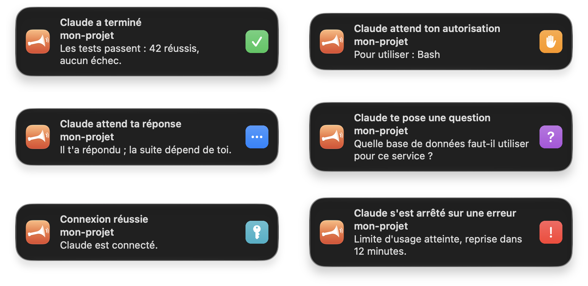
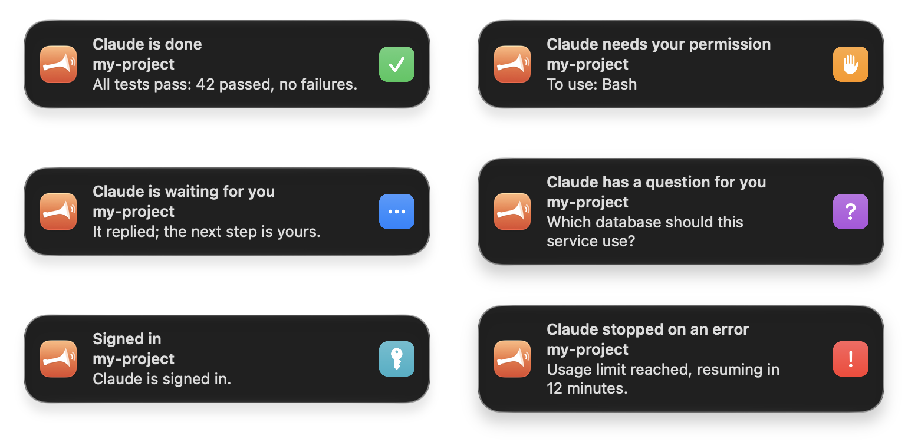

<p align="center">
  
</p>

<h1 align="center">Clairon</h1>

<p align="center">
  Des notifications macOS soignées pour les agents de code — Claude Code d'abord.<br>
  <em>Polished macOS notifications for coding agents — Claude Code first.</em>
</p>

---

**Français** · [English](#english)

Tu lances une tâche à ton agent, tu passes à autre chose… et tu ne sais pas quand il a fini, ni qu'il attend ta permission depuis dix minutes. Clairon sonne l'appel.

<p align="center">
  
</p>

| Ce qui se passe | Notification | Son |
|---|---|---|
| L'agent a fini | **Claude a terminé**, avec la première phrase de sa réponse | Glass |
| Il demande une permission | **Claude attend ton autorisation** — « Pour utiliser : Bash » | Ping |
| Il attend ta réponse depuis une minute | **Claude attend ta réponse** | Pop |
| Il pose une question | **Claude te pose une question** | Purr |
| Connexion réussie | **Connexion réussie** | Hero |
| Le tour s'arrête sur une erreur | **Claude s'est arrêté sur une erreur** — avec la raison | Basso |

- **Une application native**, avec son icône, une vignette de couleur pour chaque état et un son par état.
- **Un projet, un groupe** : les notifications d'un même projet sont rangées ensemble, et la plus récente d'une session remplace la précédente au lieu de s'empiler.
- **Un clic** ramène ton outil de travail : la fenêtre du projet dans VS Code ou Cursor, ou ton terminal (iTerm2, Terminal, Ghostty, Warp).
- **Jamais dans le chemin** : les hooks tournent en arrière-plan, Clairon ne reste pas en mémoire et n'a pas d'icône dans le Dock.
- **Français ou anglais**, selon la langue du système (ou `CLAIRON_LANG=fr|en`).

### Installer

Il faut macOS 13 ou plus récent, et les outils de ligne de commande Xcode (`xcode-select --install`).

```sh
brew install mouha7/tap/clairon
clairon install
```

Ou sans Homebrew :

```sh
git clone https://github.com/Mouha7/clairon.git ~/.clairon
~/.clairon/bin/clairon install
```

`install` fait trois choses :
- il construit `~/Applications/Clairon.app` sur ta machine ;
- il branche trois hooks dans `~/.claude/settings.json` (`Notification`, `Stop`, `StopFailure`) en fusionnant avec tes réglages, après en avoir gardé une copie datée ;
- il envoie une notification de bienvenue.

À la première, macOS te demande d'autoriser Clairon.

```sh
clairon test        # une notification de chaque état
clairon effacer     # retire du centre toutes les notifications de Clairon
clairon uninstall   # retire les hooks et l'application
```

### Interrupteurs

```sh
mkdir -p ~/.config/clairon
touch ~/.config/clairon/pause      # plus aucune notification (supprimer le fichier pour reprendre)
touch ~/.config/clairon/sans-son   # notifications muettes
```

Le clic ramène l'application détectée par `TERM_PROGRAM`. Pour en imposer une autre : `CLAIRON_APP=<identifiant de bundle>`.

### Rien n'apparaît ?

Ouvre Réglages Système › Notifications › Clairon. Un mode Concentration range les notifications dans le centre sans les afficher : ajoute Clairon à ses applications autorisées si tu veux être prévenu quand même. Dans Claude Code, `/hooks` montre les hooks branchés.

### D'autres agents

Le cœur ne connaît pas l'agent : un **adaptateur** traduit ses événements en six états communs (`clairon/adaptateurs.py`). Claude Code est le seul pour l'instant. Codex, Gemini CLI et les autres viendront si l'usage le demande, et les contributions sont bienvenues.

---

<a id="english"></a>
**English**

You hand a task to your agent, switch to something else… and never notice it finished, or that it has been waiting for your permission for ten minutes. Clairon sounds the call.

<p align="center">
  
</p>

- **A native app**, with its own icon, a colored thumbnail per state, and a sound per state:
  - done, with the first sentence of the answer;
  - permission needed;
  - waiting for you;
  - question;
  - signed in;
  - stopped on an error.
- **Grouped per project.** Within a session, the newest notification replaces the previous one instead of piling up.
- **One click** brings back your workspace: the project window in VS Code or Cursor, or your terminal (iTerm2, Terminal, Ghostty, Warp).
- **Never in the way**: hooks run in the background, and Clairon neither stays in memory nor shows a Dock icon.
- **English or French**, following the system language (or `CLAIRON_LANG=en|fr`).

### Install

Requires macOS 13 or later and the Xcode command line tools (`xcode-select --install`).

```sh
brew install mouha7/tap/clairon    # or: git clone https://github.com/Mouha7/clairon.git ~/.clairon
clairon install     # builds the app, merges three hooks into ~/.claude/settings.json (backup kept)
clairon test        # one notification per state
clairon clear       # removes Clairon's notifications from Notification Center
clairon uninstall   # removes the hooks and the app
```

To pause notifications, create `~/.config/clairon/pause`; to mute them, create `~/.config/clairon/sans-son`. A Focus mode keeps notifications in Notification Center without showing them: add Clairon to its allowed apps if you still want the banners.

### Other agents

The core does not know about agents: an **adapter** maps their events to six common states (`clairon/adaptateurs.py`). Only Claude Code is supported today. Codex, Gemini CLI and others will come if people need them, and contributions are welcome.

---

Clairon is an independent project, not affiliated with or endorsed by Anthropic. « Claude » and « Claude Code » are trademarks of Anthropic. MIT license.
